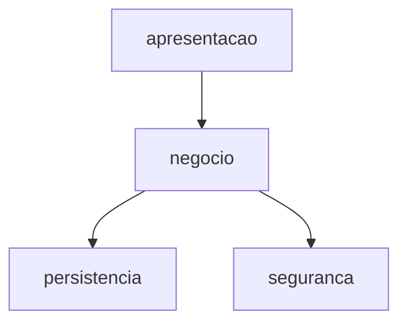

# Busca Peça — Documentação Técnica

## Visão geral
Marketplace que conecta oficinas mecânicas para compra e venda de peças novas, usadas e excedentes de estoque, reduzindo desperdício (ODS 12).

Camadas: apresentação, domínio, negócio, persistência, segurança.

## Módulos
### `buscapeca/controllers/peca_controller.py` (apresentação)
Componente da camada de apresentação (responsabilidade inferida pela estrutura). _(fonte: inferida)_
- Classe `PecaController`: `post_peca(corpo)`, `get_pecas(categoria)`
### `buscapeca/controllers/pedido_controller.py` (apresentação)
Componente da camada de apresentação (responsabilidade inferida pela estrutura). _(fonte: inferida)_
- Classe `PedidoController`: `post_pedido(corpo)`
### `buscapeca/models.py` (domínio)
Entidades de domínio do marketplace Busca Peça. _(fonte: docstring)_
- Classe `Peca`: sem métodos públicos
- Classe `ItemPedido`: `subtotal()`
- Classe `Pedido`: sem métodos públicos
### `buscapeca/repositories/conexao.py` (persistência)
Cria a conexão SQLite e o esquema mínimo do MVP. _(fonte: entrevista)_
- Função `criar_conexao(caminho)` -> sqlite3.Connection
### `buscapeca/repositories/peca_repository.py` (persistência)
Persistência de peças em SQLite (consultas sempre parametrizadas). _(fonte: docstring)_
- Classe `PecaRepository`: `salvar(peca)`, `buscar_por_id(peca_id)`, `buscar_por_categoria(categoria)`, `listar_excedentes()`, `atualizar_quantidade(peca_id, quantidade)`
### `buscapeca/repositories/pedido_repository.py` (persistência)
Persiste pedidos e atualiza seu status. _(fonte: entrevista)_
- Classe `PedidoRepository`: `salvar(pedido, total)`, `atualizar_status(pedido_id, status)`
### `buscapeca/security/crypto.py` (segurança)
Camada de segurança: derivação e verificação de senhas. _(fonte: docstring)_
- Função `hash_senha(senha, sal)` -> str
- Função `verificar_senha(senha, armazenado)` -> bool
### `buscapeca/services/auth_service.py` (negócio)
Componente da camada de negócio (responsabilidade inferida pela estrutura). _(fonte: inferida)_
- Classe `AuthService`: `registrar(email, senha)`, `autenticar(email, senha)`
### `buscapeca/services/peca_service.py` (negócio)
Regras de negócio de anúncio e busca de peças (economia circular). _(fonte: docstring)_
- Classe `PecaInvalidaError`: sem métodos públicos
- Classe `PecaService`: `cadastrar_peca(peca)`, `preco_sugerido(preco_novo, condicao)`, `buscar_disponiveis(categoria)`, `pecas_reaproveitaveis()`
### `buscapeca/services/pedido_service.py` (negócio)
Componente da camada de negócio (responsabilidade inferida pela estrutura). _(fonte: inferida)_
- Classe `EstoqueInsuficienteError`: sem métodos públicos
- Classe `PedidoService`: `calcular_total(pedido)`, `criar_pedido(comprador_id, itens)`, `cancelar(pedido)`

## Decisões de arquitetura
- **ADR 0001 - Arquitetura em camadas** (Aceito). Alternativas rejeitadas: Active Record (acopla domínio ao banco).
- **ADR 0002 - SQLite no MVP** (Aceito). Alternativas rejeitadas: PostgreSQL gerenciado (custo e consumo de recursos maiores na fase de MVP).

## Referências
- BASS, L.; CLEMENTS, P.; KAZMAN, R. Software architecture in practice. 3. ed. Boston: Addison-Wesley, 2012.
- GAMMA, E. et al. Padrões de projeto: soluções reutilizáveis de software orientado a objetos. Porto Alegre: Bookman, 2000.
